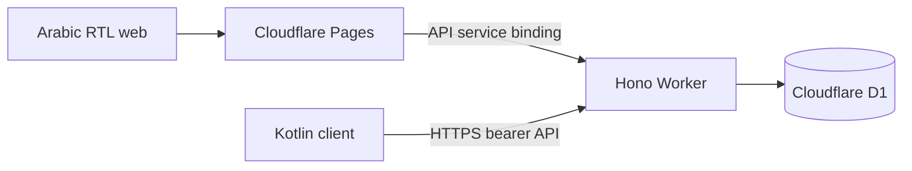

# معمارية هلال لإدارة المتجر

مرجع السلوك هو Laravel عند `90baabb4b38ae292ea7ef55806145518774991bb`. تقع الشفرة الجديدة في `cloud/` ويظل Laravel وتطبيق Kotlin في الشجرة للمقارنة.

- `cloud/web` تطبيق React وTypeScript. يمرر Vite محليًا `/api` إلى Wrangler. في Pages تقوم دالة `/api/*` بتمرير الطلب إلى `STORE_API` داخل الحساب نفسه. تستمر الجلسة على أصل الواجهة، وتصل بيانات API مع `Cache-Control: no-store`.
- `cloud/api` ينفذ المصادقة والصلاحيات والتحقق في Hono وZod. تستخدم استعلامات D1 المرتبطة SQL صريحًا حتى تكون المعاملات والقيود قابلة للمراجعة. تُحفظ قيم المال بوحدات صغرى صحيحة.
- Pages هو مسار الواجهة. يتيح Workers Static Assets دمج الواجهة والـAPI في نشر واحد والاستغناء عن وسيط Pages. اخترنا الإبقاء على Pages وفق المطلوب مع Service Binding لتوحيد أصل المتصفح. يحتاج النشر المنفصل إلى تنسيق إصدارات متوافقة.
- صور الكتالوج التجريبية ذات الصيغ المسموحة مخزنة في D1 بحد 128 KiB للصورة و100 صورة. لا يوجد bucket أو ترقية فوترة في هذا التكوين. راجع [حدود الخطة](FREE_TIER_LIMITS.md).
- الدخول التقليدي في Laravel والتوكنات القديمة يحتاجان إعادة تهيئة مستخدمين. يوجد مسار توكن للتوافق مع دخول Kotlin. راجع [توافق Android](ANDROID_COMPATIBILITY.md) قبل ربط تطبيق المتجر بالبيئة التجريبية.

المراجع الرسمية [Pages Service Bindings](https://developers.cloudflare.com/pages/functions/bindings/#service-bindings) و[Workers Static Assets](https://developers.cloudflare.com/workers/static-assets/) و[D1 Database API](https://developers.cloudflare.com/d1/worker-api/d1-database/).
